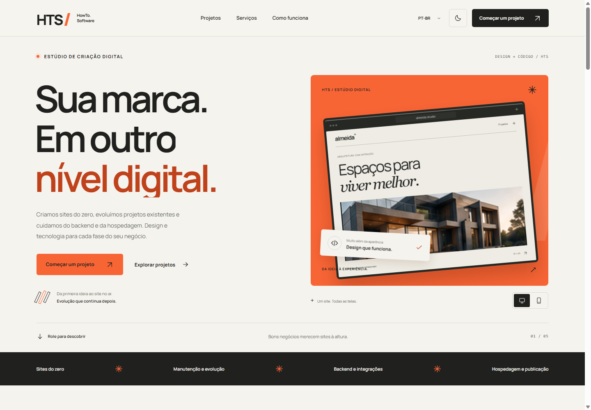

# HTS — HowTo.Software

Site de criação de sites e soluções digitais da HTS, construído com **Blazor Web App, ASP.NET Core e .NET 8**.

O frontend combina tipografia editorial, temas claro e black, detalhes em laranja, prévias de sites e animações que acompanham a navegação. As interações foram adaptadas para Razor, CSS e JavaScript nativo.



[Prévia mobile](docs/preview-mobile.png) · [Página completa](docs/preview-desktop-full.png) · [Fontes dos componentes e adaptações](docs/frontend-sources.md)

[Tema black](docs/preview-black.png) · [Black no celular](docs/preview-black-mobile.png) · [Prévia em espanhol](docs/preview-es.png)

## Executar

Instale o SDK do .NET 8 ou posterior e execute:

```powershell
dotnet restore
dotnet run --no-launch-profile --urls http://localhost:5093
```

Acesse <http://localhost:5093>. Não é necessário instalar Node, React ou pacotes npm para executar o site.

O cabeçalho oferece **PT-BR, EN e ES**, além do botão para alternar entre os temas claro e black. A escolha do idioma fica em cookie, e a do tema fica no navegador, inclusive depois de trocar o idioma. O tema claro continua sendo o padrão na primeira visita.

Português brasileiro é o idioma padrão quando não há outra preferência do navegador. Também é possível usar `/culture?culture=pt-BR&returnUrl=%2F`, `/culture?culture=en&returnUrl=%2F` ou `/culture?culture=es&returnUrl=%2F`. A troca pelo seletor mantém a seção atual da página.

## Funcionalidades

- Hero com prévia interativa de desktop e celular.
- Projetos com filtros e prévias em diálogos acessíveis pelo teclado.
- Serviços expansíveis para criação do zero, manutenção de projetos existentes, sistemas, backend, hospedagem e estratégia digital. A seleção preenche o briefing.
- Processo de trabalho, perguntas frequentes e menu responsivo.
- Briefing com projeto novo ou melhoria, validação em português, inglês e espanhol e download de TXT em UTF-8.
- Ao escolher manutenção, o briefing indica um projeto existente e oferece um campo opcional para o endereço do site. Backend e hospedagem também podem ser selecionados e aparecem no download.
- Tema black com contraste próprio para textos, formulários, prévias e estados de foco.
- Animações de entrada, links e texto da navegação; indicador de seção e progresso de leitura.
- Suporte à preferência de reduzir movimentos e conteúdo visível sem o JavaScript de animação.
- Fonte variável Manrope e imagens hospedadas localmente, sem CDN em tempo de execução.

## Estrutura

| Caminho | Responsabilidade |
| --- | --- |
| Components/Pages/Home.razor | Composição da página |
| Components/Shared | Seções, ícones, animação de texto e validação localizada |
| wwwroot/css/app.css | Identidade visual, estados e responsividade |
| wwwroot/js/interactions.js | Animações, diálogos, idioma, menu, progresso e download |
| wwwroot/js/theme.js | Tema salvo, aplicado antes do CSS, e botão acessível de alternância |
| Models/ProjectBrief.cs | Rascunho compartilhado no circuito Blazor |
| Resources | Textos em português brasileiro, inglês e espanhol |
| docs/reference-sources | Código público original coletado do Skiper UI |

## Fontes e escopo

Os componentes gratuitos Text roll navigation e CssLink do **Skiper UI** foram coletados do registry oficial e portados para Razor/CSS. A atribuição está no rodapé.

O **Mask Text Reveal do OriginKit** foi usado como referência de comportamento. O código original exige autenticação e não foi obtido; a implementação em Blazor é própria. Os detalhes e links estão em [frontend-sources.md](docs/frontend-sources.md).

O briefing é validado e pode ser baixado, mas **não é enviado, armazenado em banco ou encaminhado por e-mail**. A integração com uma API permanece para a etapa de backend. Os projetos apresentados são conceitos demonstrativos, identificados como tal.

## Validation / English

Build with `dotnet build`. Browser validation covers desktop and mobile widths from 320 to 1440 px, both themes, Portuguese, English and Spanish, project filters, dialogs, service selection, form errors and valid submissions, brief download, keyboard controls, reduced motion and visible scroll reveals. Theme and language persistence, translated downloads and browser language detection were also checked. Maintenance, backend and hosting were verified in all three languages, including the existing-project mode, optional website URL, URL validation and downloaded brief content.

This is a Blazor/.NET 8 site. It runs without npm dependencies. Quote drafts can be downloaded; there is currently no request delivery or storage backend. OriginKit behavior is independently implemented from public documentation; free Skiper UI source was obtained and adapted with attribution.
