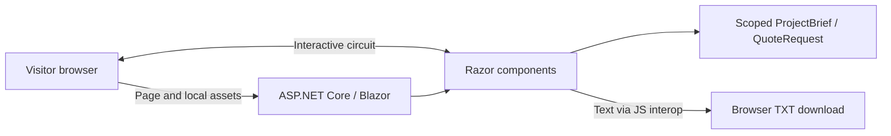

# Software architecture

> Status: Draft, pending HTS review. Owner: HTS team. Historical frontend baseline: 2026-10-02. Current edition: Unreleased.

## Runtime structure

This is one ASP.NET Core application, not a frontend/API/database platform. `Home.razor` composes the commercial sections. Interactive server components handle forms and events over the Blazor connection. Static CSS, JavaScript, fonts and images are served from `wwwroot`.

`Program.cs` configures localization, scoped draft state, static files, antiforgery and the `/culture` preference endpoint. Resources contain PT-BR, EN and ES. CSS variables and `theme.js` control themes; the saved theme is applied before styles render. `interactions.js` handles menus, native dialogs, motion and text download.

## State, security and scale

`ProjectBrief` is scoped to the circuit and publishes service-selection changes to the form. There is no durable database, object storage, email client or quote endpoint. Customer answers must not be logged or added to browser preference storage. Razor encoding and model validation remain the boundary for untrusted input.

Each connected visitor consumes server circuit resources. Production scaling must account for connection support, memory, reconnect behavior and session affinity; adding replicas alone does not make in-memory state durable. Hosting and CI/CD are [proposed guidance](../phase-5-deployment/deployment-guide.md), not provisioned infrastructure.

See [diagrams](diagrams.md), [data model](data-model.md) and [ADR index](adr/README.md). Risks include interrupted drafts, incomplete production error handling and future delivery claims exceeding implemented behavior.

**PT-BR:** uma aplicação Blazor com estado em memória; não há API separada ou banco neste projeto.
