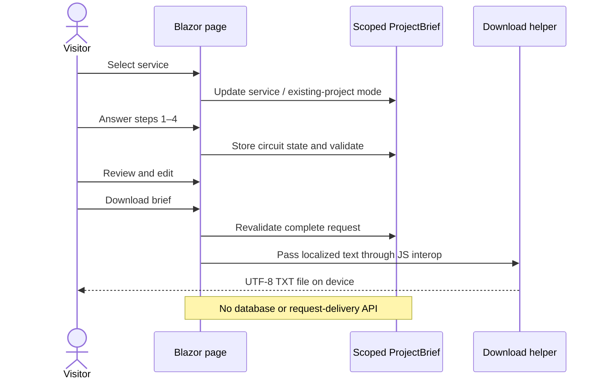
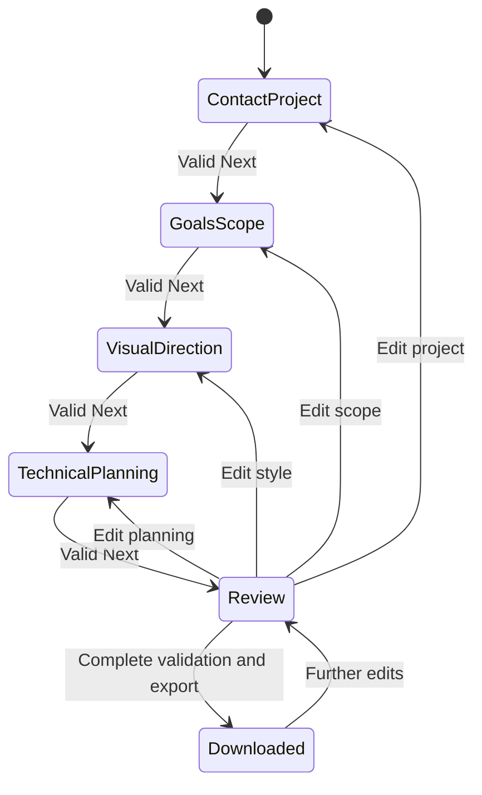

# System and wizard diagrams

> Status: Draft, pending HTS review. Owner: HTS team. Historical frontend baseline: 2026-10-02. Current edition: Unreleased.

## Request preparation

## Navigation state

Back navigation between adjacent steps also preserves the draft. A circuit expiration or reload can reset the flow. These diagrams describe preparation, not a payment, acceptance or email-submission sequence. See [architecture](architecture.md) for deployable units and [deployment guide](../phase-5-deployment/deployment-guide.md) for proposed hosting.

**PT-BR:** o diagrama termina em arquivo local; não existe seta de envio para a equipe HTS.
